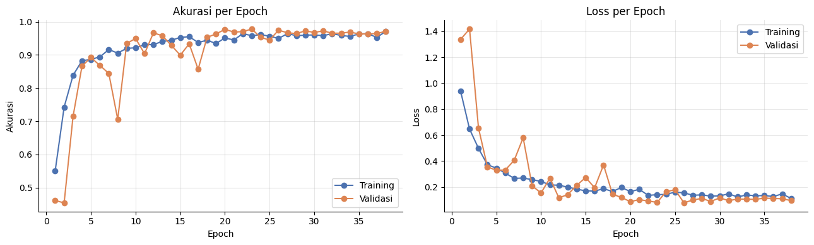
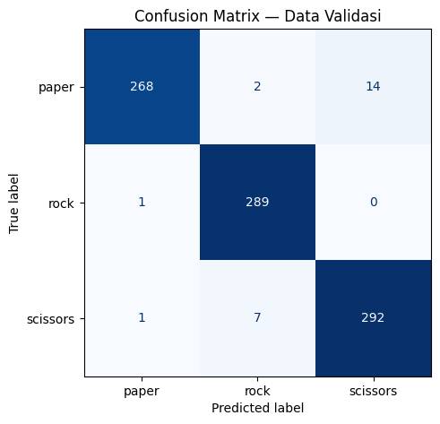
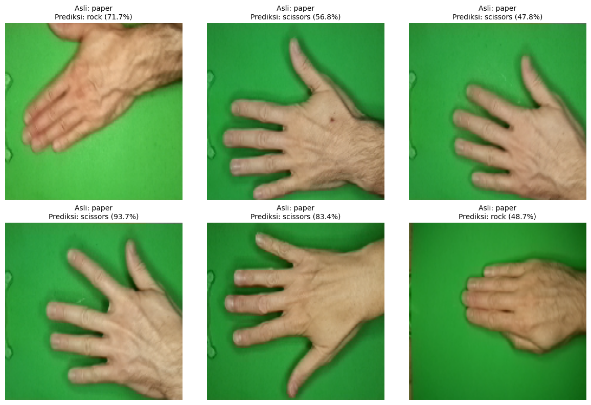
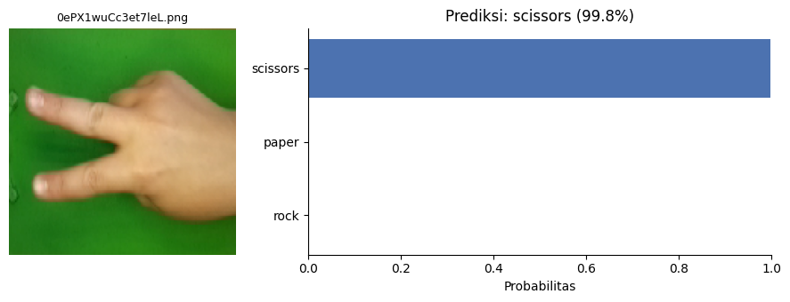

# Klasifikasi Gambar Rock–Paper–Scissors dengan CNN


Proyek akhir kelas **Belajar Machine Learning untuk Pemula** (Dicoding) — klasifikasi gambar
gestur tangan **rock / paper / scissors** menggunakan Convolutional Neural Network dari nol,
lengkap dengan evaluasi per kelas, ekspor ke tiga format produksi, dan demo inferensi.

## Ringkasan Hasil

| Metrik | Nilai |
|---|---|
| Total data | 2.188 gambar (paper 712, rock 726, scissors 750) |
| Split train / validasi | 60% / 40% → 1.314 / 874 gambar |
| Akurasi training (model final) | **98,55%** |
| Akurasi validasi (model final) | **97,14%** |
| Macro F1 | 0,9722 |
| Jumlah parameter | **111.819** (110.371 trainable) |
| Format artefak | SavedModel, TF-Lite, TensorFlow.js |
| Target tugas (≥ 85% train & val) | ✅ tercapai |

**Performa per kelas** (874 gambar validasi):

| Kelas | Precision | Recall | F1-score | Support |
|---|---|---|---|---|
| paper | 0,9926 | 0,9437 | 0,9675 | 284 |
| rock | 0,9698 | 0,9966 | 0,9830 | 290 |
| scissors | 0,9542 | 0,9733 | 0,9637 | 300 |
| **accuracy** | | | **0,9714** | 874 |

Kesalahan yang tersisa terkonsentrasi pada `paper` → `scissors` dan `scissors` → `rock`, yaitu
gestur dengan siluet paling mirip saat jari tertutup sebagian.

## Dataset

[Sumber](https://github.com/dicodingacademy/assets/releases/download/release/rockpaperscissors.zip)
(~308 MB, dataset publik *Rock Paper Scissors* oleh Laurence Moroney). Notebook mengunduh dan
mengekstrak otomatis.

```text
rockpaperscissors/
├── paper/              # gambar asli (belum di-crop)
├── rock/
├── scissors/
└── rps-cv-images/      # versi ter-crop & terpusat, 300×200 px  ← dipakai training
    ├── paper/
    ├── rock/
    └── scissors/
```

Training memakai `rps-cv-images` karena sudah dinormalisasi (objek terpusat, latar bersih),
sehingga model konvergen lebih cepat dan hasil antar-run lebih stabil.

## Pendekatan

CNN dari nol — bukan transfer learning — dengan arsitektur ringan:

| Blok | Layer | Fungsi |
|---|---|---|
| 1 | `Conv2D(32) + BatchNorm + ReLU + MaxPool` | tepi & kontur |
| 2 | `Conv2D(64) + BatchNorm + ReLU + MaxPool` | bentuk jari/telapak |
| 3 | `Conv2D(128) + BatchNorm + ReLU + MaxPool` | gestur utuh |
| 4 | `GlobalAveragePooling2D` | ringkasan feature map (pengganti `Flatten`) |
| 5 | `Dropout(0.5)` | regularisasi |
| 6 | `Dense(128) + ReLU` | kombinasi fitur |
| 7 | `Dense(3) + Softmax` | probabilitas 3 kelas |

**Keputusan teknis penting**

- **`GlobalAveragePooling2D`** menggantikan `Flatten + Dense(512)`: parameter turun dari
  ~1,27 juta menjadi ~111 ribu (≈12× lebih kecil) → risiko overfit lebih rendah dan artefak
  TF-Lite jauh lebih ringan.
- **Augmentasi ringan** (rotasi 15°, zoom & shift 0,1, flip horizontal). Dataset sudah bersih;
  augmentasi agresif (rotasi 40° + shear 0,2) justru memperlebar jurang train–val.
- **Generator validasi terpisah tanpa augmentasi** (`rescale` saja, `shuffle=False`) agar metrik
  deterministik dan confusion matrix valid.
- **`BatchNormalization(momentum=0.9)`**, bukan default 0,99 — dengan hanya ~42 step/epoch,
  running statistics default terlalu lambat mengikuti data (lihat riwayat iterasi).
- **Semua callback memantau `val_loss`**, bukan `val_accuracy`. Akurasi bersifat "tangga" dan
  bisa beku di satu nilai, sehingga `EarlyStopping` salah menyimpulkan tidak ada kemajuan.
- **`ValDistributionLogger`** mencetak distribusi prediksi validasi setiap epoch sebagai pengaman
  terhadap *mode collapse* (model memprediksi satu kelas saja tetap terlihat "wajar" ~33%).

## Riwayat Iterasi

| Iterasi | Konfigurasi | Akurasi validasi | Temuan |
|---|---|---|---|
| v1 | LR 1e-3, BN momentum 0,99, rotasi 40° + shear 0,2, ES pada `val_accuracy` | 33,18% | Model memprediksi **satu kelas** (`[0, 874, 0]`), `val_loss` naik 1,10 → 3,68 (softmax saturasi). `val_accuracy` beku sejak epoch 1 → `restore_best_weights` justru mengembalikan bobot **epoch 1**, dan artefak yang diekspor adalah model terburuk |
| v2 | LR 5e-4, BN momentum 0,9, augmentasi ringan, callback & checkpoint pada `val_loss`, + logger distribusi, `ReduceLROnPlateau(factor=0,5, patience=3)` | **97,14%** | Ketiga kelas terprediksi seimbang `[270, 298, 306]` vs label `[284, 290, 300]` |

**Pelajaran teknis:** pada dataset kecil dengan `steps_per_epoch` rendah, running statistics
`BatchNormalization` butuh `momentum` lebih kecil agar mengikuti distribusi data. Selain itu,
metrik berbentuk tangga seperti akurasi bukan pemicu `EarlyStopping` yang baik — dan akurasi
agregat bisa menyamarkan model yang kolaps, sehingga distribusi prediksi per kelas perlu dipantau.

## Struktur Repositori

```text
KlasifikasiGambar-Dicoding/
├── Proyek_Akhir_Klasifikasi_Gambar.ipynb  # notebook utama (deliverable)
├── README.md
├── pyproject.toml / uv.lock               # dependensi (uv)
├── models/                                # artefak ekspor
│   ├── saved_model/                       # di-commit ke GitHub
│   ├── model.tflite                       # di-commit ke GitHub
│   └── best.keras                         # checkpoint lokal (tidak di-commit)
├── assets/
│   ├── samples/                           # gambar untuk demo inferensi
│   └── screenshots/                       # tangkapan layar untuk README
└── rockpaperscissors/                     # dataset lokal (tidak di-commit, ~308 MB)
```

## Cara Menjalankan

### Google Colab (rekomendasi untuk training penuh)

1. Buka notebook di Colab.
2. `Runtime → Change runtime type` — GPU jika tersedia (CPU sudah memadai untuk dataset ini).
3. `Runtime → Run all`. Dataset diunduh otomatis (~308 MB) dan diekstrak ke `/content`.
4. Total waktu ±20 menit di CPU Colab.

### Lokal dengan `uv` (Windows / macOS / Linux)

Butuh **Python 3.11** (TensorFlow 2.15 belum mendukung 3.12+).

```bash
uv init --python 3.11
uv venv --python 3.11
uv add "tensorflow==2.15.*" matplotlib numpy scikit-learn pillow
uv add --dev jupyterlab ipykernel nbqa ruff
uv run python -m ipykernel install --user --name klasifikasi-gambar \
    --display-name "Python (Klasifikasi Gambar)"
uv run jupyter lab
```

Pilih kernel **Python (Klasifikasi Gambar)**, lalu `Run All`. Dataset diunduh ke folder kerja saat ini.

Konversi ke TensorFlow.js memerlukan paket tambahan:

```bash
uv add tensorflowjs   # jika konflik dependensi, jalankan konversi di Colab
# atau: uv pip install tensorflowjs
```

### Catatan TensorFlow ≥ 2.16

TF ≥ 2.16 memakai Keras 3: `tf.keras.preprocessing.image.ImageDataGenerator` tidak tersedia dan
layer menolak argumen `input_shape`. Repositori ini dipin ke **`tensorflow==2.15.*`**.
Alternatif: `pip install tf-keras` lalu impor dari `tf_keras.preprocessing.image`.

## Struktur Notebook

1. Latar belakang & tujuan
2. Dataset — unduh, statistik per kelas, EDA
3. Data preparation — split 60/40, augmentasi, generator
4. Arsitektur model
5. Training — callbacks, kurva akurasi & loss
6. Evaluasi — diagnostik model, classification report, confusion matrix, galeri salah prediksi
7. Export & deployment — SavedModel, TF-Lite (+ verifikasi paritas), TensorFlow.js
8. Demo prediksi (upload di Colab / folder `assets/samples` di lokal)
9. Kesimpulan, limitasi, riwayat iterasi, referensi

## Tangkapan Layar

| Kurva training | Confusion matrix |
|---|---|
|  |  |

| Galeri salah prediksi | Demo inferensi |
|---|---|
|  |  |

## Limitasi

- Model hanya mengenali gestur dengan latar polos dan pencahayaan wajar; latar ramai menurunkan akurasi.
- Gestur mirip (`rock` dengan jari sedikit terbuka, `scissors` yang hampir menggenggam) masih
  menjadi sumber kesalahan utama.
- Dataset kecil (2.188 gambar) membatasi generalisasi ke kondisi nyata yang beragam.
- Angka 97,14% diukur pada validation set yang juga dipakai untuk memilih epoch terbaik, sehingga
  estimasinya sedikit optimistis. Evaluasi independen memerlukan test set terpisah.
- Hasil dapat berbeda sedikit antar-run meskipun seed diatur (augmentasi acak, operasi
  non-deterministik pada CPU/GPU).

## Pengembangan Selanjutnya

- **Transfer learning** (MobileNetV2 / EfficientNetB0) sebagai pembanding kuantitatif.
- **Grad-CAM** untuk memastikan model fokus pada tangan, bukan latar.
- **Aplikasi web** (TensorFlow.js) atau **Android** (TF-Lite) memakai artefak hasil ekspor.
- Menambah data dengan variasi latar, pencahayaan, dan kulit/tangan yang lebih beragam.

## Lisensi

MIT — lihat `LICENSE`. Dataset mengikuti lisensi sumber aslinya dan dipakai untuk keperluan edukasi.

## Referensi

1. Dicoding Indonesia. *Belajar Machine Learning untuk Pemula* — modul klasifikasi gambar.
2. Moroney, L. *Rock Paper Scissors* dataset. Kaggle.
3. Chollet, F. *Deep Learning with Python*, 2nd ed. Manning, 2021.
4. TensorFlow. *Image classification tutorial* — https://www.tensorflow.org/tutorials/images/classification
5. TensorFlow. *Post-training quantization* & *TensorFlow.js converter*.
6. Ioffe, S., & Szegedy, C. (2015). *Batch Normalization*.
7. Lin, M., Chen, Q., & Yan, S. (2013). *Network In Network* (asal Global Average Pooling).

## Alat Bantu & Kolaborasi

Analisis, debugging, dan penyusunan dokumentasi pada proyek ini dibantu oleh **DeepSeek V4.1 Flash
Free** yang dijalankan melalui **OpenCode** sebagai asisten coding (AI copilot) — mencakup
penelusuran penyebab model kolaps pada iterasi pertama, penyusunan ulang sel training/evaluasi,
penyusunan sel diagnostik, dan draf README ini.

Seluruh keputusan akhir, eksekusi eksperimen, verifikasi hasil, serta tanggung jawab atas isi
laporan tetap berada pada penulis.